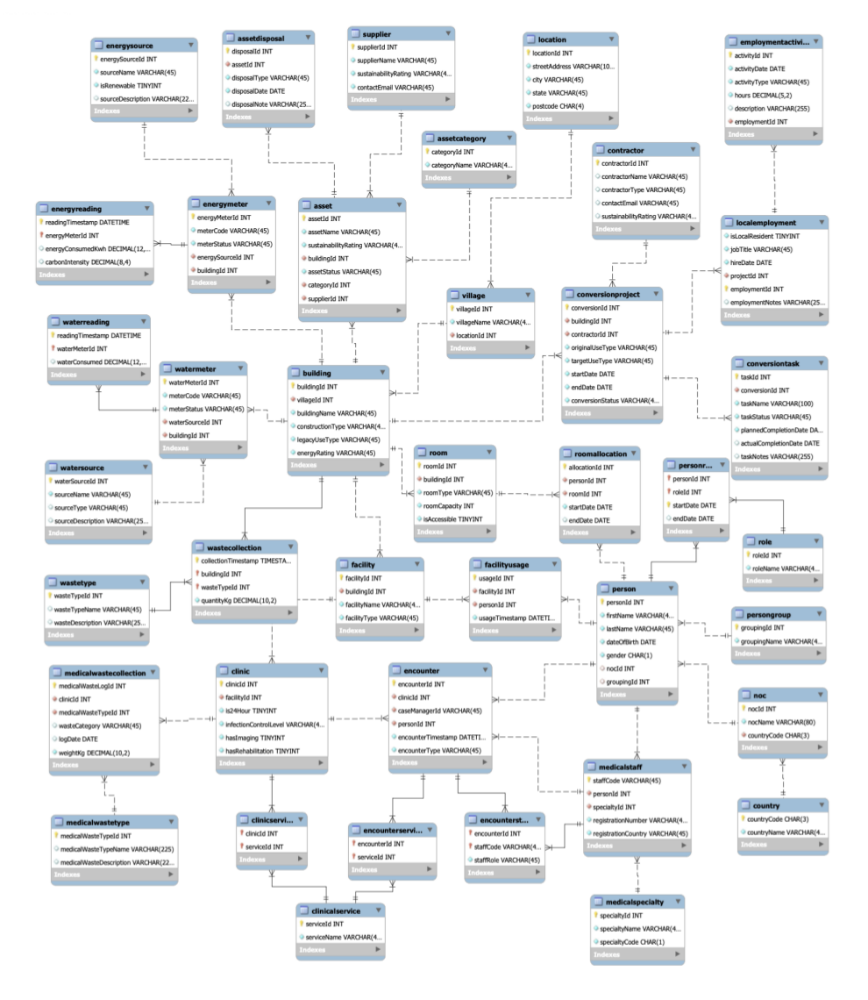

# UQx2032BrisbaneOlympics-LegacyDB

**A database project for managing the Olympic Athletes’ Village and its transition into housing and community infrastructure.**

[繁體中文](README.zh-TW.md) · [Business case](docs/project-overview.md) · [Data model](docs/data-model.md) · [Data dictionary](docs/data-dictionary.md) · [Query guide](docs/query-guide.md)

This UQ BISM7206 team project models a fictional Brisbane 2032 village scenario. It connects village operations, sustainability monitoring and post-Games legacy planning in a relational database. It is an academic prototype, with no affiliation to the IOC or Brisbane 2032 organising bodies.

**41 domain tables · 46 foreign-key constraints · 5 reporting views · 6 analytical query files · 3,681 demo records**



*Historical diagram from the source report. The executable schema also includes `roomconversion`, which the supplied diagrams/models omit.*

## The business problem

The village must work during the Games and deliver value after them. Managers need to know which buildings consume the most energy, where waste is generated, how assets will be reused, how accommodation will be converted, and whether the work benefits the local community. A connected data model makes those questions traceable across buildings, suppliers, contractors and conversion projects.

| Area | What the database supports |
| --- | --- |
| People and accreditation | People, NOCs, countries, groups and time-bound roles |
| Infrastructure | Villages, buildings, rooms, allocations, facilities and usage |
| Sustainability | Energy and water meters, timestamped readings, general and medical waste |
| Medical operations | Clinics, services, specialties, staff and encounters |
| Asset lifecycle | Suppliers, asset categories, asset status and disposal records |
| Post-Games conversion | Contractors, projects, tasks and room conversion records |
| Social impact | Employment records and work activities linked to conversion projects |

## Start with MySQL 8

Requires MySQL 8.0+; the reporting SQL uses CTEs and window functions. MySQL Workbench can be used as the SQL client.

### Docker Compose

Install Docker with Compose, then from this directory:

```bash
cp .env.example .env
# Set your own local MYSQL_ROOT_PASSWORD in .env before starting.
docker compose up -d --wait
python3 scripts/validate_mysql.py --docker
```

The first launch initializes an empty persistent database from `database/01_schema.sql`, `02_demo_data.sql` and `03_views.sql`. The SQL port is bound to `127.0.0.1:3307` by default. Initialization scripts run only when the volume is empty. Existing volumes are not automatically rebuilt. Use a dedicated demo instance: the scripts create a database named `olympicdb`.

### Existing MySQL / Workbench

1. Open a dedicated empty demo server or schema; do not import into an existing operational database.
2. Run the three SQL files in `database/` in numeric order.
3. Open any file in `queries/` and execute it. Each query selects `olympicdb` and sets its own reporting dates.
4. Run `checks/01_foreign_keys.sql`: every `violations` count should be zero. Review `checks/02_quality_review.sql` separately.

For command-line validation, set `MYSQL_HOST`, `MYSQL_PORT`, `MYSQL_USER` and `MYSQL_PWD` in your local environment, then run `python3 scripts/validate_mysql.py`. Do not commit credentials.

## Management queries

| Query | Decision supported | Techniques |
| --- | --- | --- |
| [Q1 — Energy](queries/01_energy_consumption.sql) | Identify the highest-consuming building and village | Reporting view, joins, date boundaries, aggregation, `DENSE_RANK` |
| [Q2 — Waste](queries/02_waste_compliance.sql) | Compare general and clinical waste hotspots | `UNION ALL`, conditional aggregation, ranking |
| [Q3 — Asset disposal](queries/03_asset_disposal.sql) | Compare planned recycling, donation and resale methods | `LEFT JOIN`, standardisation, `ROW_NUMBER`, percentage shares |
| [Q4 — Local employment](queries/04_local_employment.sql) | Measure local participation among recorded workers and work hours | Distinct counts, conditional sums, protected division |
| [Q5 — Conversion outcomes](queries/05_conversion_outcomes.sql) | Summarise buildings and room stock by completed conversion target | Latest-record selection, CTEs, zero-inclusive comparison |
| [Q6 — Legacy impact](queries/06_legacy_impact_ranking.sql) | Rank conversion projects with an illustrative composite score | Pre-aggregation, window functions, weighted scores |

Q5 retains two original result variants. Q6 uses `DENSE_RANK <= 10`, so tied ranks can return more than ten rows. The composite score is a project assumption, not an official sustainability standard. Read the [query guide](docs/query-guide.md) before interpreting outputs.

## Repository contents

| Location | Contents |
| --- | --- |
| `database/` | Split schema, demo data and portable view definitions |
| `queries/` | Six runnable reporting files, with reporting logic preserved |
| `checks/` | Referential-integrity and data-quality review SQL |
| `scripts/` | MySQL validation, dependency-free adapted-query check and schema-specific demo identity replacement |
| `docs/` | Business overview, schema dictionary, model, query interpretation and limitations |
| `models/` | Both historical MySQL Workbench models, with author identifiers removed |
| `evidence/` | Adapted-query outputs and a machine-readable validation record |
| `.github/workflows/` | MySQL 8 integration workflow to run after GitHub publication |

## Verification and limitations

The preparation environment had no MySQL server or Docker. All 41 tables and 3,681 rows loaded into an adapted SQLite schema, all 46 foreign-key relationships had zero orphan records, and all six reporting files produced nine result sets. [Evidence](evidence/README.md) records the scope and dialect changes. These results do **not** establish MySQL runtime compatibility. The MySQL validation script and CI workflow are supplied for that next check.

The supplied Workbench models contain 40 tables and omit `roomconversion`, which is present in the database backup. The executable schema follows the backup. A stray spreadsheet import table is excluded from the execution copy. The original report also contains inconsistencies in query presentation and claims broader controls than the schema implements; see [known limitations](docs/known-limitations.md).

## Authorship and provenance

Original team: **Purple Chase (T1G2)**, as named in the report; supplied filenames use `PurpleChess`. Contributors listed in the report are Chieh-Yu Liu, Yi-Cheng Lee, Ziqi Huang and Yi-Cong Zhu. This is collaborative work.

The project log attributes sustainability modelling, integrated ERD reviews, six management questions, SQL query development, query explanations and final SQL integration to **Yi-Cheng Lee (Eason Li)**. That attribution describes documented responsibilities and does not imply sole authorship of the entire database. See [contributions](docs/contributions.md).

The original report describes a mixture of fictional/generated test records and public reference data. For this public technical edition, person names and birth dates, staff registration numbers, supplier/contractor names and contact emails are replaced with deliberate demo placeholders; identifiers and relationships are preserved. Measurements and project records remain academic test data and must not be presented as real Games data. See [provenance](docs/provenance.md).

Original reports, the team charter, raw source workbooks and original database backups are excluded from this public repository. The complete private source package is retained separately. No new open-source licence is assigned to team-owned work. See [publication notes](docs/publication.md).
